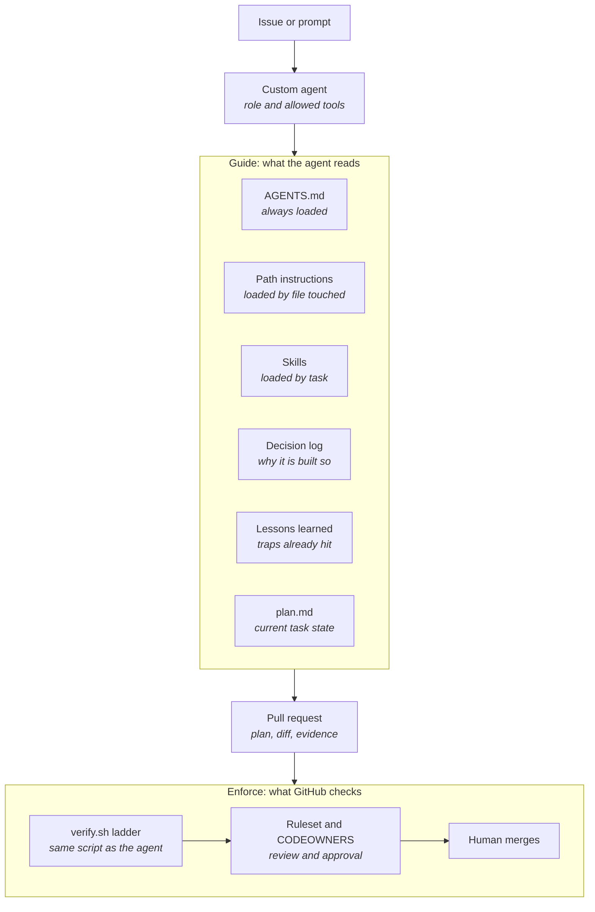

# How the pieces connect

One request goes in. The agent loads guidance in layers, works, and opens a pull request.
GitHub then checks the result before a human merges.

## The six kinds of file

| File | Answers | Loaded | Example |
|---|---|---|---|
| `.github/agents/*.agent.md` | **Who** is working, with which tools | When you pick the agent | `reviewer` can read but not edit |
| `AGENTS.md` | **What always applies** | Every task | "Every endpoint has a test" |
| `.github/instructions/*.instructions.md` | **Rules for these files** | When a file matching `applyTo` is touched | Editing `api/src/routes/` loads the API rules |
| `.github/skills/*/SKILL.md` | **How** to do this kind of task | When the task matches the skill's description | `verify-ladder` before claiming success |
| `docs/decisions/`, `LESSONS.md` | **Why** it is built this way, and **what went wrong** before | Read by the agent when planning or debugging | 0001: data stays behind `Repo` |
| `plan.md` | **Where** this task is up to | Written and updated during the task | Ticked steps, handoffs |

## The one idea to remember

Everything in the top half is **guidance**: the agent can misread or ignore it. Everything
in the bottom half is **enforcement**: it holds whether the agent behaves or not. A good
agent setup needs both, and each guideline that matters has a matching check.
